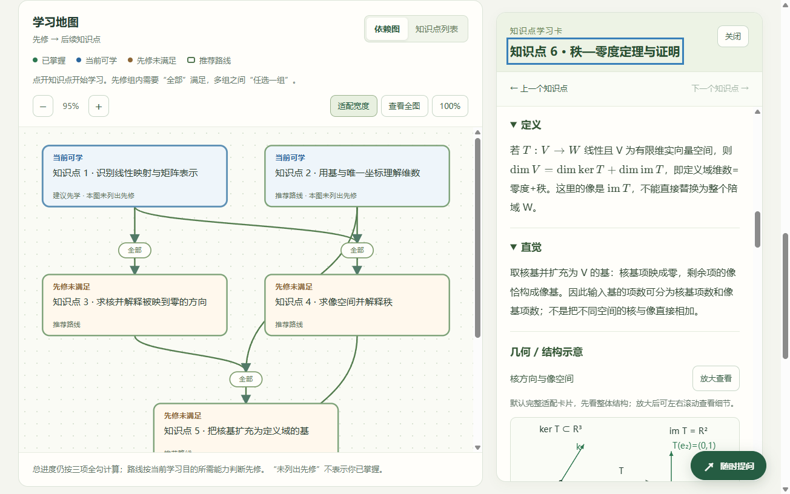
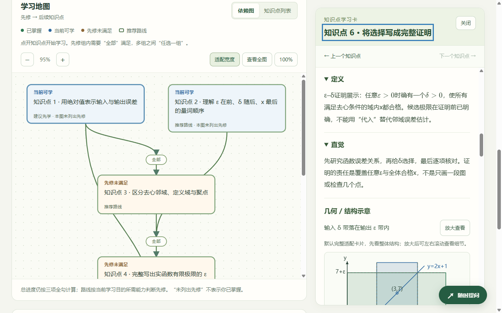

# MathPath v0.5.0

MathPath 是面向数学学习的 Windows 原型：输入一个具体目标或最多 5000 字的短文本，用通用 LLM 生成知识点和 AND/OR 先修关系，再由 Python / NetworkX 计算学习子图。学习者可以查看解释、完成练习、记录笔记，在可移动的提问窗口连续追问，将学习历史归入项目，并在下次恢复学习。

每张图最多 12 个知识点。内置同调、秩—零度、ε–δ 极限三套完整样例可离线使用；生成新目标、未缓存的学习卡，以及明确选择的模型反馈或追问，需要自己的模型连接。格式校验不能证明数学正确，生成内容和候选反馈需要核对。

数学内容评测与软件测试分开记录：程序通过检查，表示功能按预期运行；实际模型评分需要调用模型、保留原始回答，再由能核查相应数学的人评分。具体流程见 [评测说明](evals/README.md) 和 [试验计划](evals/experiment-plan.md)。当前评测材料中的空表与模拟状态不代表已完成实验。





## Windows 安装与便携运行

发行文件夹包含安装版 `MathPath-setup-0.5.0-windows-x64.exe`、便携版 `MathPath-desktop-0.5.0-windows-x64.exe`、使用说明和第三方许可；独立发行检查报告提供软件验证证据。

- 安装版：双击安装程序，安装到当前用户的 `%LOCALAPPDATA%\Programs\MathPath`，创建桌面与开始菜单快捷方式，无需管理员权限。
- 便携版：双击程序即可运行。程序内含 Python 运行时，不需要另装 Python、虚拟环境或打开终端。
- 环境：Windows 10/11 64 位，Microsoft Edge WebView2 Runtime，以及 .NET Framework 4.6.2 或更新版本。缺少 WebView2 时，从 [微软官网](https://developer.microsoft.com/microsoft-edge/webview2/) 安装。

此原型尚未做 Windows 代码签名。发行包不含开发者的账号、API 密钥、私人学习历史或虚拟环境。内置样例先离线运行即可，不必先登录。

桌面窗口使用自己的 WebView2，只监听 `127.0.0.1`。首次选择空闲本机端口，以后保留这个端口；如果被其他程序占用，会提示处理占用后重开。重复启动会回到已有窗口，关闭窗口会停止对应的本机服务。

## 从一个学习目标开始

1. 首次打开可使用固定同调样例；在样例选择中可切换到秩—零度或 ε–δ 极限，再点击载入。以后恢复本机已保存的历史，不会因此调用模型。
2. 选择“建立直觉”“学会计算与使用”“能够说明与证明”或“补齐当前卡点”，输入目标后点击“生成学习图”。模式用于新目标和当前先修推荐；切换模式不会自动改写已存练习。
3. 查看“可检验的学习目标”、共同数学约定和出处。可完成或跳过短诊断，允许回答“不确定”。
4. 点击地图、列表或建议路线中的知识点，打开学习卡。定义、直觉、例子、证明思路、先修摘要和习题均在卡片内；图和卡使用同一套“知识点 N”编号。
5. 先写自己的回答，再按需查看提示或参考。微练习作本地答案检查；开放题默认提供本地参考对照，明确勾选“请模型检查”才发送作答给模型。
6. 记录自己的理解与疑问。练习证据和自报掌握分别保存；一道题答对、浏览内容、查看参考或收到模型意见，不会自动勾选整个知识点已掌握。
7. 根据反馈选择“再试一次”“查看先修”“对照参考”或“独立检验”。这些下一步按钮不会自动请求新的模型回答。未缓存先修卡的生成仍需你明确点开。
8. 完成最后独立检验，或从复习列表、混合练习返回旧内容。独立检验是作答入口和学习记录，不等同正式证明验证或已证实的学习成效。

输入“我想学习拓扑学”等学科级目标时，先显示若干具体方向。需要你选择一个方向，并点击“以所选目标生成学习图”才调用当前模型；取消可返回修改目标。细分来自本地预设，不另用模型生成，程序不会代选。明确的题目、公式、长数学段落或具体目标通常直接进入构图。当前规则只覆盖目录中的常见宽泛主题，没有识别到不代表任意目标都已足够具体。修改下一条目标草稿不会改写正在查看的历史目标。

桌面宽窗口支持图与卡并排查看，窄窗口默认使用可搜索列表，卡片全屏打开。支持缩放、适配宽度、查看全图、上一节点和下一节点；Esc 关闭弹窗或全屏学习卡，Tab 在当前弹窗内移动。

## 可移动的提问窗口

点击右下角“随时提问”打开窗口。拖动标题栏改变位置，拖动右下角调整大小；也可以将键盘焦点放在标题栏或右下角手柄，用方向键移动或调整，Shift 加方向键步幅更大。窗口会限制在当前可见区域内；“↺”恢复位置与大小，“−”折叠，“×”关闭并保留当前草稿。窗口不会遮罩整页，可以继续查看地图和宽屏学习卡。历史、模型设置或窄屏全屏卡打开时，提问窗口暂时隐藏，退出后恢复。

在“围绕”选择当前学习目标或某个知识点；已经载入的所选学习卡会随问题提供给模型，不会为了提问自动生成新卡。Enter 换行，Ctrl / ⌘ + Enter 发送。连续问答显示在同一窗口，模型回答会标注需要数学核对，不自动改变掌握状态或判定证明成立。

提问本身过于宽泛时，窗口也会先显示方向选项。选方向只填入较具体的草稿，核对上方所选知识点后再点击发送；“这一步为什么”等具体上下文追问不会被强制改成学科目录。长度超过范围检查上限的长问题继续按原问题发送，不自动截断为另一个目标。

“使用当前模型回答”默认勾选；**点击发送才请求当前配置的模型，消耗相应额度或费用**。请求包括当前问题、学习图、所选已载入卡片，以及最多最近 10 轮成功问答；近期问答合计不超过 60000 字符，过长时只发送更短的最新连续片段。不会读取其他历史或项目作为对话上下文。打开、拖动、选知识点、折叠或恢复窗口都不会请求模型。取消勾选进入本地参考模式，只展示已有材料，不宣称已为新问题生成回答。

成功问答保存到当前学习历史，并随该条历史恢复和导出。尚未关联历史的自由提问只在本页暂存，关闭软件后不会恢复；新建图不会自动把临时问答归入新记录。切换历史或学习图会停止等待旧问题，并清空旧草稿；迟到回复不会写入新记录。删除当前历史后，窗口也不继续展示那条已删除的问答。需要保留时，应先导出对应历史。

失败会保留输入草稿，不自动重试；“取消等待”只停止本页等待，已发出的模型请求可能仍消耗额度。折叠或关闭窗口不会自动重发，也不取消当前请求。收到回复但保存失败时，页面会说明未保存；请先解决顶部保存提示或导出当前进度，再切换记录。

## 未解决问题

点击页头“未解决问题”，或在历史窗口切换同名选项卡，可以查看独立保存在本机的问题记录。模型请求失败、模型明确表示不确定或未答出时，后端尝试保存当时的问题、学习目标、知识点名称与已有回复；页面会区分已保存和保存未完成。网络请求没有到达后端、超时或存储失败时，不保证已经自动保存，可点击“存入未解决问题”手动补存。回复下的“仍未解决，记下来”也可记录自己尚未弄懂的问题。

列表支持按“未解决 / 已解决 / 全部”筛选和搜索，展开查看当时的内容，打开仍存在的关联历史，以及手动点击“我已解决”或“重新打开”。后续收到新回答不会自动将旧问题标为解决；回答状态是候选意见，不是数学证明验证。相同上下文中的同一个未关闭问题重复记录时会合并为一条。

可以逐条选择或全选当前列表，再确认删除所选问题，也可单独删除。删除问题保留学习历史和问答；删除关联历史时，问题快照仍保留，关联变为独立记录。无学习历史的提问也能存入这个列表，因此它与仅在本页暂存的自由问答不同。单条“导出进度”不包含整个未解决问题列表；使用“完整备份学习库”可一起备份全部问题及其解决状态。

## 历史记录与项目

点击“历史 / 项目”打开本机学习库。成功生成图、载入一个新样例或导入进度，会创建一条新的历史；生成失败不会创建成功记录，也不会覆盖当前学习图。

- 搜索：按历史标题或学习目标搜索，可查看全部历史、某个项目或“未分类”，并按需载入更多记录。
- 项目：在“管理项目”创建项目、修改名称；历史标题也可以单独修改。
- 归类：选择一条或多条历史，在目标项目下拉框中选择项目，再点“移入项目”。选择“未分类”可移出项目。
- 批量删除历史：逐条选择，或“全选当前列表”，再点击“删除所选历史”。确认后永久删除这些历史及其学习卡、笔记、作答和问答；项目本身保留。
- 批量删除项目：在“管理项目”选择项目，再点“删除所选项目”。**项目中的历史全部保留，转到“未分类”。** 没有同时删除项目内容的默认行为。

删除操作会显示数量和后果，确认前可以取消。删除当前正在学习的历史后，页面暂时保留其图供查看或导出，但它不会被自动保存、重新创建；开始新目标或载入新样例才建立新记录。

切换历史前会先保存当前改动。连接失败或检测到另一个窗口的版本冲突时，当前页面保留改动并停止切换；可重试保存，或先导出改动再载入已存版本。迟到的生成、学习卡和反馈结果不会写入另一个历史。

## 保存、备份与升级

每条学习历史保存：学习目标和图、自报掌握、已载入的学习卡、笔记、作答时的题目快照、提示使用、反馈、复习安排、成功问答和查看方式。题目改变后不会仅凭相同题目 ID 自动套用旧答案；作答历史可展开查看当时的题目、答案和参考。

桌面数据目录为 `%LOCALAPPDATA%\MathPath`。学习库是其中的 `.mathpath\library.sqlite3`，还保存独立 WebView2 状态和固定端口配置。源码开发版默认使用项目自己的 `.mathpath`。学习库是普通本机数据库，不宣称对学习内容加密；登录和 API 配置另用 Windows DPAPI 加密。安装程序更新保留用户数据目录。

升级会将原浏览器工作区（存储格式 1 或 2，包含 v0.3 系列保存内容）迁移成历史，保留原掌握标记；旧格式的已掌握节点转换为三项全勾。迁移使用稳定标识避免重复创建，原浏览器备份保留以便恢复。不同软件数据目录各自独立；跨浏览器或从开发网页转到桌面软件，可使用导出与导入。

“导出进度”导出当前历史的学习目标、图、卡片、笔记、作答、问答和自报进度为 JSON，**不包含账号、API 密钥、登录凭证或模型连接配置**。输入框中的下一目标草稿不会覆盖所导出历史的原目标。“导入进度”兼容旧备份，并创建独立的新历史。它是单条记录的转移入口，导入文件上限 3 MiB，还须满足下列学习状态上限；无效或过大的文件不替换当前记录。

在“历史 / 项目”中点击“完整备份学习库”，会先保存当前改动，再导出全部项目、全部历史及其学习状态、问答、问题记录和解决状态。文件只使用明确列出的学习数据字段，**不含账号、密钥、登录记录、模型设置、浏览器状态或端口配置**。无需手动复制 SQLite 文件，也不要求先关闭软件。

换电脑后，点击“恢复完整备份”选择该 JSON。程序先校验格式、内容和关联，展示项目、历史、问题的数量；确认后才一次性添加。恢复为**追加**：为导入记录重新分配 ID，同时保持项目归属和问题关联；本机已有内容保留，不被覆盖。取消预览不会添加记录，格式或存储错误不会只恢复半个备份。

同一份备份默认只恢复一次，避免重复添加。即使已恢复的某些记录后来被删除，再选该文件也不会自动重建；确实需要重建时，在预览提示中明确选择再次添加。再次添加会创建整份备份的一套新记录，应先核对数量。

完整备份文件最大 **50 MiB**，最多 **5000 个项目、5000 条历史、10000 个问题**；恢复后的本机记录总数也须在这些上限内。每条历史仍须符合自己的大小和条数限制，完整备份不会放宽这些限制。备份中含个人笔记和回答，应自行妥善保管；换电脑后模型连接需要单独配置。

一条历史最多保留 **500 条作答及查看帮助的记录、100 轮成功问答**，学习状态 JSON 的 UTF-8 大小最多 **2 MiB**。到达上限会明确提示，不会静默删除旧记录；作答达到上限时本次新增结果可能只显示在页面中，问答达到上限时不再发送新问题。应先导出备份，再新建学习记录。状态大小超限时保存失败会保留页面改动并提示重试，不能把未完成的保存当作已保存。

含私人笔记或用户回答的实际数据库、导出文件及试用资料，不应直接放入公开源码仓库。对外分享软件时使用发行包；转移自己的学习内容时使用上述学习备份，不复制登录加密文件给其他人使用。

## 自报能力、推荐与学习证据

“知道定义”“理解直觉”“会使用”是学习者的自报状态。总进度只统计三项全勾的节点；标记高级节点不会自动标记它的祖先。

路线推荐按当前目的所需的自报能力判断先修：直觉模式默认需要定义与直觉，使用模式默认需要定义与使用，证明和补卡点模式默认需要三项。节点可以声明本路线需要的具体维度和能力。它们与练习证据分开，不能把一次作答当作全面掌握。

先修组内部是 AND，多个组之间是 OR。Python / NetworkX 在最多 12 个节点的小图上选择仍需学习的不同节点数量较少的可行路线，共享先修只计一次，并稳定选择同规模路线。“建议先学”是所选路线中当前先修已满足的节点，其他可学支线也可查看。编号表达本图先修层次，路线列表表达学习步骤，两者不表示唯一学习顺序。

最少节点数不等于最短时间、最低难度或最佳教学路线。OR 分支需要达到对应的学习结果；数学约定、先修理由和条件仍需人工审阅。模型生成的答案即使与自身参考一致，也保留待核对标记。开放题本地对照和模型候选反馈不能自动宣布独立通过；开放题的独立完成自评会单独注明。

复习采用简单规则：确认无提示独立完成后依次安排约 1、3、7、14、30、60 天；需要帮助或尚待核对时较早复习，答错约 10 分钟后再练。使用者可以提前复习。这是可继续调整的设计规则，不是已经验证的最优间隔，也不是学习效果结论。

## 内置内容与公式

三套完整离线样例合计 **20 个节点、20 张学习卡和 135 个唯一任务**：

| 样例 | 统一范围与目标 | 节点 / 卡片 | 唯一任务 |
| --- | --- | --- | --- |
| 同调为什么取商 | 整数系数单纯同调；比较三角形圆周与填充面 | 8 / 8 | 53 |
| 秩与零度为什么相加 | 有限维实线性映射；求核、像并用基扩充证明 | 6 / 6 | 41 |
| 把极限写成 ε–δ 证明 | 实函数有限极限；量词、去心条件、聚点和仿射函数证明 | 6 / 6 | 41 |

每套样例的任务构成为：

- 每节点 6 项：1 道选择微练习、2 道后续开放题、1 道补步骤题、1 道独立题、1 道回忆题。同调共 48 项，另两套各 36 项。
- 全图另有 2 道诊断、2 道最终检验和 1 道混合练习，共 5 项。

同一任务在诊断、卡片或复习入口出现时不重复计为新题目。生成内容也支持学习任务、分级提示、检查要点和参考，缺少几何直观时可不配图。

同调样例明确使用整数系数。取商将边界循环视为零，将相差一个边界的循环归为同一类；围绕同一个洞不必代表同一类，绕一圈、两圈或反向绕可能不同。部分卡片提供三角形方向与填充的交互示意，并同步显示链和边界关系。固定内容按 [Hatcher 的同调章节](https://pi.math.cornell.edu/~hatcher/AT/ATch2.pdf) 核对；来源、共同数学约定及审阅状态在学习目标和卡片中显示。

秩—零度样例使用 `T:R³→R²`、`T(x,y,z)=(x+z,y+z)`。核为 `span{(−1,−1,1)}`，秩 2、零度 1；核基扩充后的剩余向量的像构成像空间基。参考 [Axler《Linear Algebra Done Right》第四版](https://linear.axler.net/LADR4e.pdf) §3B，定理 **3.21**（印刷页 62–63）及基扩充 2.32。核与像分别属于定义域和陪域，图只作结构示意，不表示它们正交或在同一个三维坐标系中。

ε–δ 样例明确要求极限点为定义域聚点，使用 `f(x)=2x+1`、`a=3`、`L=7`、`δ=ε/2`，并区分极限和函数点值。参考 [MIT OCW 18.100A Lecture 13](https://ocw.mit.edu/courses/18-100a-real-analysis-fall-2020/mit18_100af20_lec13.pdf) 第 1 页 Definition 2、4 及第 2 页 Example 7、9。带状示意图声明所画的 `ε=1`、`δ=1/2` 和坐标比例；空心标记表示去心比较排除输入 `x=3`，不表示 `f(3)` 未定义。

三套内容和练习由项目自行编写，教材只作为核查与继续阅读入口。有限矩阵和误差计算已作独立算术核对；固定样例仍不是独立专家认证的 benchmark。更改新样例的数学约定、目标或答案后，不会继续冒用原本地卡片的答案认证。

公式使用随软件附带的本地 KaTeX，无需 CDN。明确的 LaTeX 数学标记可以排版；其他文字按普通文本显示。示意图通过受限图元创建 SVG，不接受模型提供的任意 HTML、原始 SVG、脚本或外部图片地址。

## 继续阅读教材

选择“能够说明与证明”时，在学习目标及当前学习卡中展示进一步教材；某个知识点的三项自报掌握全部勾选后，其学习卡也会出现“回到教材继续学习”。条目包含真实书名、作者、章节、适用理由和出版社、作者或官方课程链接，供回到原文核对条件并继续练习。

书目来自随软件维护的核实目录，通过本地规则匹配，打开教材区不调用模型编造引用。未覆盖的主题会明确说明暂无核实推荐；章节使用实际标题而非猜测页码。书目展示不等于判断你已经理解或证明了相关结果，也不表示有限目录覆盖所有合适教材。

## ChatGPT 登录与自定义 API

点击“模型 / API 设置”，选择“ChatGPT 授权”，再点“登录 / 重新连接 ChatGPT”，在系统浏览器官方页面完成授权后回到软件。桌面菜单“MathPath → 连接 ChatGPT”也保留。每名使用者连接自己的账号；可用权限以授权结果为准，不能把登录成功等同模型权限已授予。

设置窗口会显示等待、完成或错误。重复点击不会同时启动多次登录；关闭设置不取消后台授权，重开可继续查看。状态只描述本次运行中的登录尝试，初始状态不判定旧凭证是否可用。登录不会调用模型，也不自动保存或切换使用方式；原配置为 API 时，按需点击“保存并使用”切到 ChatGPT。

选择“自定义 API”时，填写平台提供的基础地址、准确模型 ID 和 API 密钥，再点“保存并使用”。基础地址通常以 `/v1` 结尾，不能填写完整的 `/chat/completions` 或 `/responses` 路径；地址与密钥是不同字段。支持 Chat Completions 或 Responses，以及 JSON 对象、严格 JSON Schema、仅提示约束三种结构化方式；第三方平台需要提供对应兼容接口。

保存只更新本机配置。点击“测试已保存 API（可能计费）”才发送短测试。生成图、未缓存卡片，以及明确选择的模型反馈或追问，会把相应目标、内容或作答发送到所选平台，并按其规则使用额度或计费；本地诊断题、参考对照、规划和笔记不会自动联网生成。失败不自动切换服务或重复请求。

API 配置位于本机数据目录的 `.mathpath\api_settings.dpapi`，使用 Windows 当前用户 DPAPI 加密。页面只显示是否保存过密钥，不回填原文或片段；留空可保留旧密钥，输入新值可替换。“清除已存密钥”会切回 ChatGPT，保留学习历史。切换服务或模型使当前生成缓存失效，但已存历史仍可恢复。

登录记录同样单独加密，正常到期使用原续期逻辑；续期失败不会自动切到普通 API 计费。网络错误保留原记录，TLS、超时和 HTTP 错误分别提示。TLS 连接失败应排查当前网络或代理，不保证重新登录即可恢复。HTTPS 保持证书校验；HTTP 只允许本机 `localhost`、`127.0.0.1` 或 `::1`。

参考：[OpenAI Python SDK](https://developers.openai.com/api/reference/python)、[结构化输出](https://developers.openai.com/api/docs/guides/structured-outputs)、[授权会话与续期](https://developers.openai.com/siwc/token-sharing-open-source/profiles-and-sessions)、[模型调用](https://developers.openai.com/siwc/token-sharing-open-source/models-and-inference)。具体平台可用性与权限需要使用者显式测试。

## 从源码运行

以下命令均在解压后的**项目根目录**运行，不需要 WSL。桌面发行版用户可以跳过这一节。源码开发需要本机 Python；依赖版本固定在 `requirements.txt`，当前已在 Windows / Python 3.14 环境开发。

```powershell
python -m venv .venv
.\.venv\Scripts\python.exe -m pip install -r requirements.txt
.\start.cmd
```

也可在资源管理器双击 `start.cmd`。启动后打开 <http://127.0.0.1:8000/>，保持启动窗口开启，Ctrl+C 停止。如果 8000 已由 MathPath 使用，会复用现有服务；其他服务占用时会提示。`/docs` 是接口调试页，正常学习请打开主页。

开发版需要重新授权时，可在页面设置中连接；命令行方式为：

```powershell
.\.venv\Scripts\python.exe -B chatgpt_login.py
```

迁移源码到其他电脑或目录时重新创建虚拟环境，不要复制旧虚拟环境或登录记录。桌面构建还需要 `desktop-requirements.txt`。构建选项可在项目根目录查看：

```powershell
.\.venv\Scripts\python.exe -m pip install -r desktop-requirements.txt
.\.venv\Scripts\python.exe -B packaging\build.py --help
.\.venv\Scripts\python.exe -B packaging\build_setup.py --help
```

## 软件验证与已知边界

在项目根目录运行离线检查：

```powershell
.\.venv\Scripts\python.exe -B tests\run_offline.py
node tests\frontend_v04.cjs
```

前端离线检查需要 Node.js，运行网页和桌面软件不需要。测试使用临时数据与本地合成响应，不读取实际授权或 API 密钥，不登录账号，不调用真实模型。前端检查还直接校验打包的数学内容及 Python 模型，覆盖目标与聊天的方向选择、教材触发、问题记录和所选删除、提问窗口移动、调整大小、键盘操作、多轮上下文、取消与迟到回复、问答保存、题目快照、候选反馈、保存冲突、迁移和历史项目批量删除。

具体测试数量与桌面、安装、升级检查结果见 `MathPath-v0.5.0-release-check.json`、对应来源窗口检查和安装检查报告；便携 ZIP 内附离线报告。报告是软件检查证据，不能替代真实联网生成、数学评审或真实用户试用。原有发行备份与记录保留。

界面参照 [W3C 对话框交互规范](https://www.w3.org/WAI/ARIA/apg/patterns/dialog-modal/) 和 [点击区域说明](https://www.w3.org/WAI/WCAG22/Understanding/target-size-minimum.html)，尚未进行完整无障碍合规评估。软件仍是小图原型，暂不接复杂 PDF、RAG 或训练模型，也不提供形式证明验证。

## 课程 Project 与评测材料

本项目适合按 NLP 课程的 Project 路线展示：“数学目标 → 结构化先修图 → 规划 → 学生作答与连续追问 → 候选反馈与下一步教学动作 → 历史记忆与项目归类”。技术任务包括结构化信息抽取、依赖规划、上下文教学反馈和持久学习状态；通用模型先作为基线，训练小模型是后续可选项。

现有数学评测包含 20 个目标、40 个模拟自报状态，覆盖线性代数、群论、同调和拓扑。六项人工维度为概念覆盖、数学正确性、依赖合理性、OR 合理性、目标匹配和状态适配；案例提供核查要点，不规定唯一标准图。

```powershell
.\.venv\Scripts\python.exe -B evals\run.py
.\.venv\Scripts\python.exe -B evals\run.py --prepare
```

以上只校验并准备构图评审空表；只有显式 `--run --case ...` 才采集真实模型输出。另已实现同模型教学决策 A/B 的采集、匿名人工评审和结果汇总工具。可先离线生成 **20 个目标、40 个模拟状态、80 行空评分计划**：

```powershell
.\.venv\Scripts\python.exe -B evals\compare.py --prepare --out evals\results\prepare
```

条件 A 得到目标、困惑和完整自报状态；条件 B 在相同输入基础上多得到人工审核的 AND/OR 图与已知节点映射。两条件共用同一模型配置、指令和输出结构，按固定种子随机交错请求。先人工核对 `reviewed-mapping-template.json` 的图与全部状态映射，填写匿名审阅者及批准证据，再显式开始小规模真实采集；未批准映射不能直接运行。

下面示例只采集一个目标的两个状态、两个条件、每条件 3 次，合计 **12 次真实请求**，使用当前账号额度或 API 费用：

```powershell
.\.venv\Scripts\python.exe -B evals\compare.py --run --mapping evals\results\prepare\reviewed-mapping-template.json --case homology_quotient --trials 3 --out evals\results\pilot
```

采集后生成匿名评审材料，保管揭盲文件，待人类评分完成再汇总：

```powershell
.\.venv\Scripts\python.exe -B evals\compare.py --blind evals\results\pilot\decision-collection.jsonl --out evals\results\blind
.\.venv\Scripts\python.exe -B evals\compare.py --summarize evals\results\pilot\decision-collection.jsonl --reviews evals\results\blind\anonymous-review.json --key evals\results\blind\unblinding-key.json --out evals\results\summary
```

`compare.py` 是命令行入口，`review.py` 实现匿名评审与评分校验。未填写的分数保持空值，不当作 0 分；汇总保留失败、缺失、未评数量与有效配对分母，不让模型给自己评分。这项比较评估**人工审核结构上下文对教学决策输出的影响**，不能证明自动构图可靠，也不能测出学习效果。本轮交付工具和空表，没有填造真实模型分数或真人反馈；真实 pilot 需要明确采集后再人工评分。

详见 [数学评测说明](evals/README.md)、[试验计划与报告模板](evals/experiment-plan.md)、[Project 评估与真实试用方案](evals/project-evaluation.md) 和 [真实用户反馈空表](evals/user-feedback-template.csv)。

课程交付还需要实际模型内容评审、至少 3 名真实用户的意见及改进依据。本仓库提供源码、运行说明、固定样例与评测工具。上述文档和空表不表示评估工作已完成；离线检查、模拟状态和预存 Demo 也不能作为真实学习效果的证据。要声称提高学习，还需真实的独立前测、后测、延迟检验和适当比较设计。

## 代码与许可

| 文件 | 作用 |
| --- | --- |
| `main.py` | FastAPI 主页、样例目录、构图、卡片、规划、学习反馈与学习库/备份接口 |
| `graph_builder.py` / `planner.py` | 结构化图及学习约定校验、AND/OR 先修规划 |
| `lesson_builder.py` / `study_builder.py` / `teaching_help.py` | 学习卡、任务、保守反馈、复习规则及明确请求的追问 |
| `library_models.py` / `library_store.py` | 学习状态、题目快照、SQLite 历史、项目与问题、版本冲突及完整备份恢复 |
| `learning_guidance.py` | 本地宽泛目标细分、核实教材目录和匹配规则 |
| `llm_client.py` / `model_settings.py` | 通用模型、结构化输出、显式服务选择和加密 API 配置 |
| `chatgpt_login.py` / `chatgpt_connection.py` | 官方授权、加密记录、续期及共用后台进度 |
| `desktop.py` / `packaging/` | 独立 Windows 窗口、本机服务及按清单发行构建 |
| `static/` | 本地响应式界面、地图、学习卡、方向选择、教材、可移动提问窗口、问题与历史管理、SVG 和 KaTeX |
| `examples/` | 三套图与卡：`homology_*`、`rank_nullity_*`、`epsilon_delta_*`，共 20 节点、135 唯一任务 |
| `evals/run.py` / `evals/compare.py` / `evals/review.py` | 构图采集、同模型教学决策比较、匿名人工评审与诚实汇总 |
| `evals/` / `tests/` | 人工评测、真实试用准备材料、完整备份及多样例等离线软件检查 |

第三方依赖及本地 KaTeX 许可随发行文件提供，见便携发行目录的 `licenses`。数学题、解释和图示为项目编写，教材链接提供核查入口。公开源码前排除 `.mathpath`、实际数据库、授权、密钥以及含私人学习内容的结果文件。
